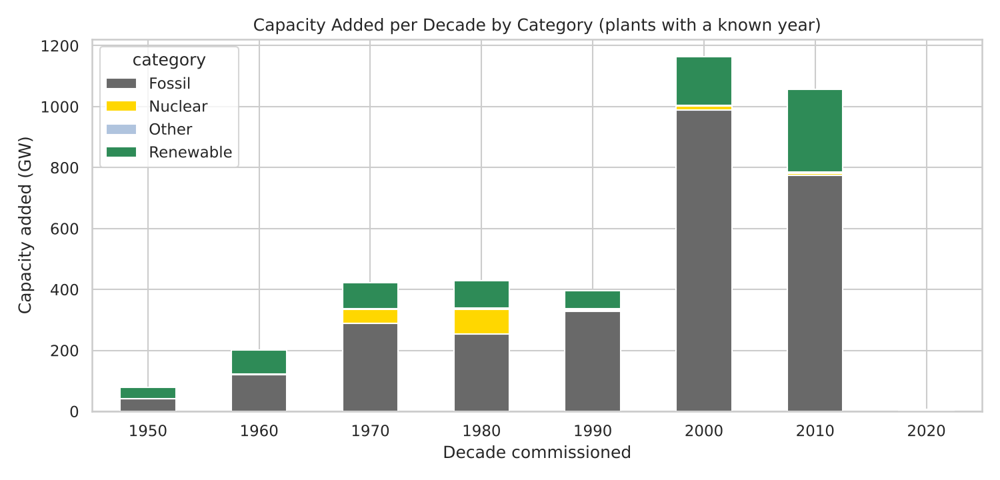
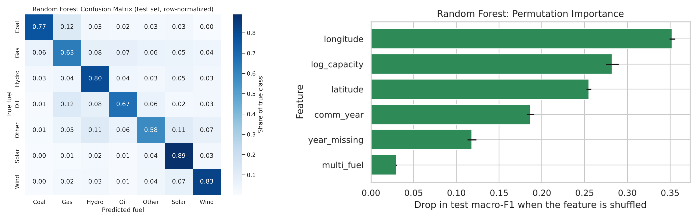
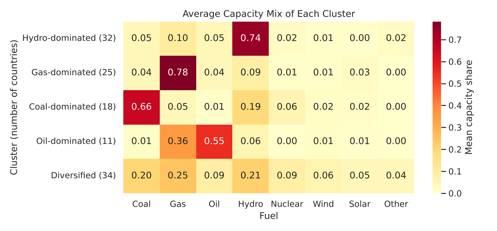

# Introduction

Electricity generation is the largest source of energy-related carbon emissions, and replacing coal,
oil and gas plants with wind, solar, hydro and other low-carbon capacity is the core of the energy
transition. This project uses the **Global Power Plant Database** (version 1.3.0; Global Energy
Observatory, Google, KTH Royal Institute of Technology in Stockholm, Enipedia and World Resources
Institute, 2021; licensed CC BY 4.0), an open inventory of **34,936 power plants in 167 countries**. For
each plant it records the country, generating capacity (MW), latitude and longitude, primary fuel (15
categories), commissioning year when known, owner and data source, reported annual generation for
2013–2019 where available, and WRI's modelled estimate of generation for 2013–2017. The database is a
2021 snapshot, so newer plants are missing.

The core fields (capacity, location, fuel) are complete, but the commissioning year is missing for
**50.1%** of plants, and unevenly: 67% of solar plants lack it against 19% of coal plants. Fuels were
grouped into seven classes (Solar, Hydro, Wind, Gas, Coal, Oil and Other), capacity was log-transformed
(it ranges from 1 to 22,500 MW), and missing years were filled with the median (2007) plus a flag
recording that the year was unknown. Counting plants and counting megawatts give opposite pictures:
**solar has the most plants (10,665) but only 3.3% of capacity**, while **coal has 2,330 plants and
34.4% of capacity** (median plant size 5.8 MW for solar, 600 MW for coal). Among plants with a known
commissioning year, fossil fuels made up most new capacity in every decade up to the 2010s (85.0% in the
2000s), but renewables' share rose to 25.8% in the 2010s and 75.4% for plants commissioned in 2020
(Figure 1). All analysis was done in both Python and R.

{width=58%}

# Question 1: Can a plant's primary fuel be predicted from its basic attributes?

## Introduction

Energy datasets in many countries list plants with a location and capacity but a missing or unreliable
fuel type. This question asks whether the fuel can be inferred from six basic attributes: capacity,
latitude, longitude, commissioning year, whether that year is missing, and whether a secondary fuel is
listed. The target is the seven fuel groups. I am interested in it because filling and checking such
gaps matters for tracking where the transition is happening.

## Approach

Three classifiers were compared: **multinomial logistic regression** (a linear baseline on
standardized features), a **decision tree** (depth 8, at least 20 plants per leaf) and a **random
forest** (300 trees). The classes are unequal (from 10,665 solar to 2,320 oil plants), so each model
weighted the classes equally, and the main metric is **macro-F1**, the average F1 score over the seven
classes, so that small classes count as much as large ones. The data were split 80/20 stratified by fuel,
with 5-fold cross-validation in two forms: ordinary random folds, and folds **grouped by country**, which
test whether a model works for a country it has never seen. Feature importance was measured by
**permutation importance** (the drop in macro-F1 when a feature is shuffled). WRI's estimated generation
was excluded, because WRI estimated it from the fuel type itself; a separate run tested what happens if
that **leaky** feature is included.

## Data analysis and results

| Model | Test accuracy | Test macro-F1 | CV macro-F1, random folds | CV macro-F1, country folds | With leaky capacity factor |
|---------------------|-------|-------|---------------|---------------|-------|
| Logistic regression | 0.480 | 0.412 | 0.418 ± 0.006 | 0.282 ± 0.026 | 0.525 |
| Decision tree | 0.550 | 0.525 | 0.538 ± 0.007 | 0.279 ± 0.064 | 0.828 |
| Random forest | **0.782** | **0.739** | 0.729 ± 0.004 | 0.332 ± 0.035 | 0.965 |

: Fuel classification results (Python). R gives the same pattern: random-forest test macro-F1 0.684, country-fold CV 0.330.

On a random split, the **random forest identifies the fuel group of 78% of plants** (macro-F1 0.739),
far ahead of the decision tree (0.525) and logistic regression (0.412). It recognizes solar (recall
0.891), wind (0.827), hydro (0.796) and coal (0.770) best; its main errors are between thermal fuels
(12.5% of oil plants and 12.2% of coal plants are predicted as gas). **Location matters most**
(shuffling longitude lowers macro-F1 by 0.352, latitude by 0.255), followed by capacity (0.282) and
commissioning year (0.186). However, when whole countries are held out, macro-F1 falls to **0.332**. With
the leaky capacity factor, macro-F1 would jump to 0.965, because that feature is nearly fixed within
fuels (for example, the middle half of solar plants lie between 0.172 and 0.211).

## Discussion

A plant's fuel can be inferred well **within countries the model has seen**: plants of the same fuel
cluster geographically (solar farms in sunny regions, hydro plants along rivers), and the random forest
learns these locations, together with the clear size differences between fuels. It does **not**
generalize to unseen countries (macro-F1 0.33), so it is useful for filling gaps in a well-covered
country but not for a country with no labelled plants. Thermal fuels are hard to separate from size and
location alone. The leakage check is a key lesson: a feature that looks informative may simply encode the
answer, and checking where each feature comes from matters as much as choosing the model. Limitations:
half the commissioning years are imputed, coverage varies by country (the United States contributes 28%
of plants), and the data stop in 2021.

# Question 2: Which groups of countries share similar generation mixes?

## Introduction

Countries start the energy transition from very different places. A hydro-based system is already
largely low-carbon, while a coal-based one faces the hardest task. This question groups countries by
the share of their capacity in eight fuel groups (coal, gas, oil, hydro, nuclear, wind, solar and other),
using the 120 countries with at least 1 GW of capacity, which hold 99.7% of the database's capacity. I am
interested in it because countries in the same group face similar choices and can learn from each other.

## Approach

**k-means clustering** was applied to the eight capacity shares. The shares are already on a common
0–1 scale, so no standardization was needed. The number of clusters was chosen with the **elbow method**
and the **silhouette score**: the silhouette is highest at k = 4 (0.384) and almost identical at k = 5
(0.382), and k = 5 was chosen because its extra cluster separates oil-dominated from gas-dominated
countries. Each k-means run used 50 random starts. As a robustness check, **hierarchical clustering**
(Ward linkage) was run with the same k and compared using the **adjusted Rand index** (1 = identical
groupings, 0 = chance agreement). Principal component analysis gave a two-dimensional view.

## Data analysis and results

| Cluster | Countries | Capacity | Mean mix | Examples |
|------------------|----------|----------|----------------------|------------------------------|
| Hydro-dominated | 32 | 494 GW | 74% hydro | Brazil, Canada, Norway, Sweden, Colombia |
| Coal-dominated | 18 | 2,001 GW | 66% coal, 19% hydro | China, India, South Africa, Indonesia, Poland |
| Gas-dominated | 25 | 415 GW | 78% gas | Italy, Iran, Egypt, UAE, Netherlands |
| Oil-dominated | 11 | 132 GW | 55% oil, 36% gas | Saudi Arabia, Iraq, Cuba, Lebanon |
| Diversified | 34 | 2,648 GW | 25% gas, 21% hydro, 20% coal | USA, Russia, Japan, Germany, France, UK |

: The five k-means clusters (Python). R assigns 119 of the 120 countries to the same cluster.

{width=66%}

The four "dominated" clusters are tight (mean silhouette 0.43–0.49), and hierarchical clustering
reproduces them almost exactly. The **diversified** cluster is a looser catch-all (mean silhouette
0.149); hierarchical clustering sends 9 of its 34 countries to the coal group, which is why the adjusted
Rand index is 0.623 (0.646 in R). In the PCA view the first component (49% of variance) runs from hydro
to gas and the second (30%) measures coal. **No cluster is led by wind or solar**: their mean shares are
2.6% and 2.2%, with maxima of 33.5% and 27.9%.

## Discussion

The world's large electricity systems fall into five recognizable types. The **coal-dominated** group
contains only 18 countries but 35% of the database's capacity, including China and India, and is where
decarbonization matters most. **Hydro-dominated** countries are already largely low-carbon; gas- and
oil-dominated countries, many of them fossil-fuel producers, face different economic pressures. The
diversified group holds the largest economies, where wind (6%), solar (5%) and nuclear (9%) shares are
highest, but even there no renewable source dominates. This confirms Part 1: in this 2021 snapshot the
transition is visible in *new* capacity rather than in countries' overall mix. Limitations: the mix is
measured by capacity, not generation (a megawatt of solar produces far less energy than a megawatt of
coal), and database coverage varies. For example, Denmark appears coal-dominated (63% coal, 17% wind)
because few of its many wind farms are listed, and Estonia appears oil-dominated because its oil-shale
plants are recorded as oil.

# References

Global Energy Observatory, Google, KTH Royal Institute of Technology in Stockholm, Enipedia, World
Resources Institute (2021). *Global Power Plant Database*, version 1.3.0.
https://github.com/wri/global-power-plant-database. Licensed CC BY 4.0.

Byers, L., Friedrich, J., Hennig, R., Kressig, A., Li, X., McCormick, C., & Malaguzzi Valeri, L. (2018).
*A Global Database of Power Plants*. Technical note, World Resources Institute.

Han, J., Pei, J., & Tong, H. (2023). *Data Mining: Concepts and Techniques* (4th ed.). Morgan Kaufmann.

**Code:** `python/01–03_*.ipynb` and `r/01–03_*.Rmd` in the project folder reproduce every result.
